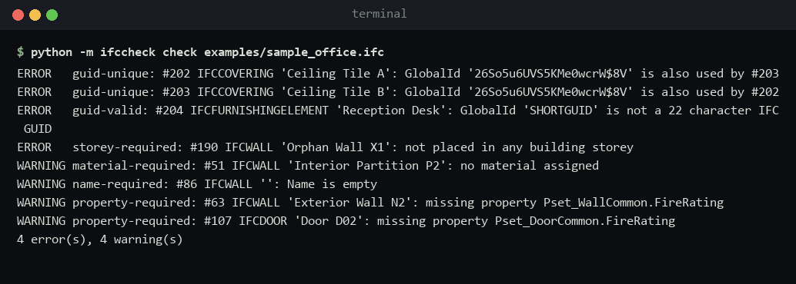

# ifc-model-checker

An IFC file can open fine in a viewer and still be unfit for handover: two elements share a GlobalId, a wall sits outside every storey, a door has no fire rating. This repo reads IFC STEP text with the Python standard library only (no ifcopenshell), runs a set of rules and lists each problem with the entity number, type and name. Rules are plain JSON, so you can tighten them per project.



## What it is for

BIM coordinators, project engineers and facility managers receiving a model need a quick pass or fail before it goes into an asset register or maintenance system. This tool gives them a readable list of what to send back to the modeler, and a JSON output other scripts can use.

## Install

```
git clone https://github.com/yassine2med/ifc-model-checker
cd ifc-model-checker && pip install -r requirements.txt
```

No third-party packages are needed. Python 3.10 or newer.

## How to use

| I want to | Command |
|---|---|
| Run the default rules on a model | `PYTHONPATH=src python -m ifccheck check examples/sample_office.ifc` |
| Use my own rules | `PYTHONPATH=src python -m ifccheck check examples/sample_office.ifc --rules examples/rules_strict.json` |
| Get JSON for another tool | `PYTHONPATH=src python -m ifccheck check examples/sample_office.ifc --format json` |
| Fail on warnings too | `PYTHONPATH=src python -m ifccheck check examples/sample_office.ifc --strict` |
| Count entities by type | `PYTHONPATH=src python -m ifccheck summary examples/sample_office.ifc` |
| Print the default rules to copy and edit | `PYTHONPATH=src python -m ifccheck rules` |

Exit codes for `check`: 0 when there are no errors, 1 when errors exist (or warnings with `--strict`), 2 when the file is missing or not IFC STEP.

Example:

```
PYTHONPATH=src python -m ifccheck check examples/sample_office.ifc
```

Output:

```
ERROR   guid-unique: #202 IFCCOVERING 'Ceiling Tile A': GlobalId '26So5u6UVS5KMe0wcrW$8V' is also used by #203
ERROR   guid-unique: #203 IFCCOVERING 'Ceiling Tile B': GlobalId '26So5u6UVS5KMe0wcrW$8V' is also used by #202
ERROR   guid-valid: #204 IFCFURNISHINGELEMENT 'Reception Desk': GlobalId 'SHORTGUID' is not a 22 character IFC GUID
ERROR   storey-required: #190 IFCWALL 'Orphan Wall X1': not placed in any building storey
WARNING material-required: #51 IFCWALL 'Interior Partition P2': no material assigned
WARNING name-required: #86 IFCWALL '': Name is empty
WARNING property-required: #63 IFCWALL 'Exterior Wall N2': missing property Pset_WallCommon.FireRating
WARNING property-required: #107 IFCDOOR 'Door D02': missing property Pset_DoorCommon.FireRating
4 error(s), 4 warning(s)
```

Entity summary:

```
schema IFC4, 231 entities
  42  IFCRELDEFINESBYPROPERTIES
  39  IFCQUANTITYLENGTH
  31  IFCPROPERTYSINGLEVALUE
  23  IFCELEMENTQUANTITY
  19  IFCPROPERTYSET
  14  IFCQUANTITYAREA
  12  IFCQUANTITYVOLUME
   8  IFCWALL
   7  IFCRELAGGREGATES
   5  IFCMATERIAL
   5  IFCRELASSOCIATESMATERIAL
   4  IFCSPACE
   3  IFCDOOR
   3  IFCWINDOW
   2  IFCBUILDINGSTOREY
```

Run the tests with `python -m pytest -q`.

## How it works

1. `src/ifccheck/ifc.py` splits the DATA section into statements, then parses each `#12=IFCWALL(...)` into an entity with references, strings, enums, numbers and lists. Typed values such as `IFCLABEL('x')` are unwrapped.
2. It builds indexes from the relationship entities: property sets, quantity sets, spatial containment, material association and aggregation.
3. Rules in `src/ifccheck/checker.py` run on that model: project structure, GUID format and uniqueness, names, storey placement, materials, required properties (`Pset.Property`) and a minimum space area.
4. Errors are listed first. Exit code follows the error count.

The sample file `examples/sample_office.ifc` is a small hand written IFC4 model (8 walls, 3 doors, 3 windows, 2 slabs, spaces) with deliberate defects so every rule has something to find.

## Limits

- Reads IFC STEP text (`.ifc`) only. No IFCXML, no zipped files.
- It checks data quality, not geometry. It never looks at shapes or placements.
- Property sets are read from `IfcPropertySingleValue` only; quantities from `IfcElementQuantity`.
- Walls inside a storey that a door or window fills are not traced through openings; fixtures must be contained in a storey directly.

## License

MIT. Yassine Emhamed, 2026.
